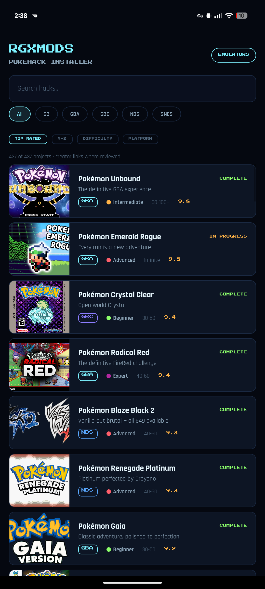
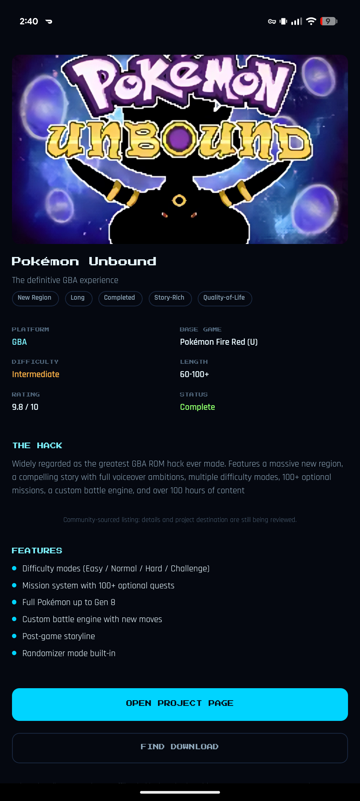
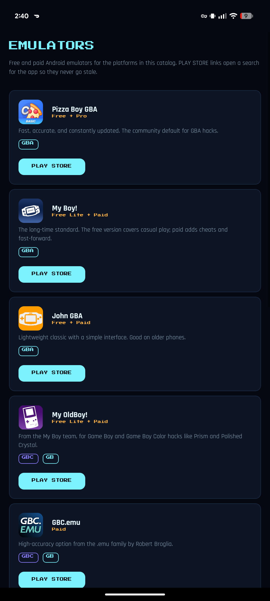

# RGX PokeHack Installer

Browse, compare, and find download pages for Pokémon ROM hacks. The app ships a
curated catalog of community hacks with cover art, difficulty, length, platform,
and status, plus direct links to each project's page and an emulator directory
for Android.

No ROMs are bundled or distributed. The app opens the creator's project page or
a web search for the download, so links never go stale.

<p align="center">
  
  
  
</p>

## Features

- **437+ hack catalog** across GB, GBA, GBC, NDS, and SNES with cover art.
- **Search and filters** by platform, plus sort by rating, name, difficulty, or
  platform.
- **Detail pages** with base game, difficulty, length, rating, status, feature
  list, and creator/project links.
- **Emulator directory** with per-platform Play Store links (Pizza Boy, My Boy!,
  John GBA, My OldBoy!, GBC.emu, and more).
- **Offline-friendly data** — the catalog is bundled; no account or backend.
- Dark, pixel-styled UI built with Expo / React Native.

## Install

Download the latest signed APK from the
[Releases page](https://github.com/DonnieDice/pokehack-installer/releases).

The release APK embeds the JS bundle and launches standalone (no Metro needed).
Android 6.0+ is required.

## Development

```bash
npm install
npm start          # Expo dev server (press a for Android, w for web)
npm test           # Jest unit tests
npm run web        # Expo web dev server
```

Build an Android APK:

```bash
npx expo prebuild -p android --no-install
cd android && ./gradlew assembleRelease
```

The signed release build runs in CI on `main` and requires the protected
signing variables documented in `.gitlab-ci.yml`.

## Project layout

```text
App.js                    Navigation shell and screens
src/components/           Cards, filters, shared UI
src/screens/              Catalog, detail, emulators
src/data/                 Bundled hack catalog
src/utils/                Patch engines (parked) and helpers
assets/covers/            Generated cover art
scripts/                  Cover/asset generation and APK verification
docs/                     Catalog policy, research, store publishing notes
```

## Docs

- [Catalog content policy](docs/CATALOG_CONTENT_POLICY.md)
- [Catalog research](docs/CATALOG_RESEARCH.md)
- [Play Store publishing](docs/PLAY_STORE_PUBLISHING.md)
- [Roadmap / TODO](TODO.md)
